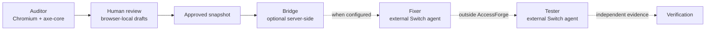

<h1 align="center">AccessForge</h1>

<p align="center"><strong>Scan. Review. Approve. Verify.</strong></p>

<p align="center">
  A real Chromium + axe-core accessibility audit, a browser-local review and approval workflow,
  and an optional server-side Switch handoff for human-approved fixes.
</p>

<p align="center">
  <a href="https://github.com/Divya2007-hub/AccessForge"></a>
  
  
  
  
  
  
  
  
</p>

<p align="center"><sub>Phase 3A prototype · Local-first review · Docker-ready · Not a compliance certification service</sub></p>

---

> **Project status.** The core scanner, report, browser-local review, approval trail, and approved-fix export are implemented. The optional Switch bridge is implemented server-side but is disabled unless configured explicitly. Fixer and Tester agents are external Switch agents and are not bundled in this repository.

## Why AccessForge

Automated accessibility tools are good at finding issues and weak at closing the loop. A scan is not a fix. A generated patch is not an approval. AccessForge keeps every handoff explicit and reviewable.

| The gap | AccessForge's answer |
| --- | --- |
| Scanners produce long issue lists with no review path. | Real findings become a structured report with severity, selectors, failure summaries, documentation, and remediation guidance. |
| AI-generated fixes are hard to trust or audit. | Drafts come from deterministic, rule-based templates. A human edits and approves the exact proposed HTML. |
| Fixes get applied without evidence or sign-off. | Approval stays local and explicit. Nothing is written to source code, committed, or opened as a pull request. |
| Teams lose the reason behind a decision. | The browser stores drafts, approvals, rejections, reopen events, notes, and timestamps in a local audit trail. |
| “Accessibility score” dashboards hide the details. | AccessForge reports observed axe-core results and refuses to invent a composite compliance score. |

## Product surface

> **Screenshots are not committed yet.** The repository currently contains no product screenshots. The cards below are clearly labeled placeholders, not image claims. Add real captures under `docs/screenshots/` before publishing a visual showcase.

<table>
  <tr>
    <td align="center" width="50%">
      <strong>Scanner</strong><br />
      <sub>Placeholder for <code>docs/screenshots/scanner.png</code></sub>
    </td>
    <td align="center" width="50%">
      <strong>Scan report</strong><br />
      <sub>Placeholder for <code>docs/screenshots/report.png</code></sub>
    </td>
  </tr>
  <tr>
    <td align="center" width="50%">
      <strong>Fix review</strong><br />
      <sub>Placeholder for <code>docs/screenshots/review.png</code></sub>
    </td>
    <td align="center" width="50%">
      <strong>Before / after demo</strong><br />
      <sub>Placeholder for <code>docs/screenshots/demo.png</code></sub>
    </td>
  </tr>
</table>

## How it works

1. **URL scan.** A public URL, or the bundled demo file, is loaded in headless Chromium at a 1366×900 desktop viewport with a light color scheme.
2. **Accessibility findings.** axe-core runs with WCAG 2.0, 2.1, and 2.2 A/AA tags plus best-practice rules. Results are stored in the browser, not on the server.
3. **Fix proposals.** Supported findings become deterministic draft HTML changes. Unsupported rules stay in manual review.
4. **Human approval.** A person edits the proposed HTML, reviews the before/after comparison, and approves, rejects, or reopens the draft. Approval is blocked while a bracketed placeholder remains or the HTML is unchanged.
5. **Switch coordination (optional).** When the optional Switch bridge is configured, the server can post an approved snapshot to a Switch room for separately configured Fixer and Tester agents.
6. **Independent verification.** Verification happens outside AccessForge. The application never applies or verifies a code change itself.

The first four steps are implemented in the app. Step 5 is optional and only available when a Switch bridge is explicitly configured. Step 6 is deliberately outside the product boundary.

## Feature highlights

| Feature | What it actually does |
| --- | --- |
| Real browser scans | Launches Playwright Chromium and runs axe-core against one page. No mocked findings. |
| Guarded remote targets | Validates URLs, resolves DNS, blocks private and reserved addresses, blocks non-standard ports, and re-checks every browser request. |
| Structured reports | Shows impact, affected elements, selectors, HTML snippets, failure summaries, rule documentation, remediation, and manual checks. |
| Deterministic fix drafts | Supports `image-alt`, `button-name`, `link-name`, `select-name`, `label`, `input-button-name`, `html-has-lang`, and `frame-title`. |
| Human-in-the-loop review | Edit, save, approve, reject, and reopen drafts with a local decision history. |
| Approved-fix export | Downloads a JSON handoff bundle and a fragment diff containing only approved HTML snapshots, notes, and timestamps. |
| Bundled accessibility demo | Includes an intentionally inaccessible baseline and a verified repaired copy for a repeatable before/after comparison. |
| Optional Switch bridge | Real server-side status, room activity, and approved-fix dispatch routes. Never enabled by default. |
| Honest guardrails | No composite score, no compliance claim, no code modification, no pull requests, no hidden agent output. |

## Multi-agent architecture

AccessForge separates detection, human approval, coordination, and verification.

| Role | Where it lives | Responsibility | Status |
| --- | --- | --- | --- |
| **Auditor** | This repository | Runs the real browser scan, groups findings, and builds the report. Read-only. | Implemented |
| **Human reviewer** | This repository, browser-local | Edits deterministic drafts and records the approval decision. Final authority. | Implemented |
| **Bridge** | This repository, server-side | Checks Switch health, reads room activity, and posts approved snapshots to a configured room. | Implemented, optional |
| **Fixer** | External Switch agent | Consumes approved handoffs and proposes repairs outside AccessForge. | Not bundled |
| **Tester** | External Switch agent | Produces independent verification evidence outside AccessForge. | Not bundled |



The browser-local review system and the Switch agent workflow are separate. The local workflow works without Switch, credentials, or network access. The current Switch setup is demonstrated locally; a public deployment would need a reachable HTTPS bridge and durable storage if handoff history must survive restarts. For a public deployment, keep all `SWITCH_*` variables unset; the UI then reports Switch as unconfigured.

## Verified before and after results

The bundled demo is checked by the standalone `npm run demo:a11y` script. It loads both files directly with `file://`, runs axe-core with WCAG 2.0, 2.1, and 2.2 A/AA tags, and verifies the keyboard and mobile behaviors. This is a repeatable repository check, not a third-party audit or a compliance certificate.

| File | Violation rules | Affected elements | Remaining rule IDs |
| --- | ---: | ---: | --- |
| `demo-site/index.html` | 6 | 19 | `button-name`, `color-contrast`, `html-has-lang`, `image-alt`, `link-name`, `select-name` |
| `demo-site/index.repaired.html` | 4 | 14 | `color-contrast`, `html-has-lang`, `link-name`, `select-name` |

The repaired copy resolves `button-name` and `image-alt`. It keeps four rule types and still has non-violation issues such as a skipped heading level and landmark issues. It is an intentional demonstration, not a fully accessible page.

The keyboard check confirms that the header search link moves focus to `FORM#gear-search`, and Tab reaches the search input. At 375×667, the search link stays visible while the Gear, Guides, and Journal links are hidden.

The in-app demo scanner enables additional WCAG 2.2 and best-practice rules, so its report can contain more findings than the standalone comparison above. See [`demo-site/README.md`](demo-site/README.md) for the focused technical reproduction.

## Tech stack

| Layer | Technology |
| --- | --- |
| Framework | Next.js 16.4.3 App Router |
| UI | React 19.3.1, Tailwind CSS 4.3.3, Radix Slot, Lucide icons |
| Language | TypeScript 5 |
| Scanner | Playwright 1.64.1 Chromium, axe-core 4.14.0, `@axe-core/playwright` |
| Validation | Zod 4 |
| Storage | Browser `localStorage`; no server-side database |
| Testing | Playwright Test and axe-core checks |
| Deployment | Docker, official Playwright image, Render, Node.js 20.9+ |

### Repository layout

```text
src/app/                  Next.js pages, layouts, and API routes
src/components/           App shell, report, review, Switch, and UI components
src/lib/scanner/          URL guard, Playwright/axe orchestration, WCAG data
src/lib/review/           Deterministic recipes, review state, approved-fix export
src/lib/switch/           Optional server-side Switch bridge
src/lib/client/           localStorage history, review storage, fetch helpers
src/lib/server/           API helpers and in-memory rate limiting
demo-site/                Intentional baseline and verified repaired copy
scripts/                  Standalone demo comparison and Switch setup
tests/                    Playwright and axe test suite
```

## Quick start

Prerequisites:

- Node.js 20.9 or newer
- npm
- A Chromium build for Playwright

```bash
git clone https://github.com/Divya2007-hub/AccessForge.git
cd AccessForge
npm install
npx playwright install chromium
npm run dev
```

Open <http://localhost:3000>. The bundled demo audit works without any external network access.

### Configuration

Copy the example environment file only if you need to override defaults:

```bash
cp .env.example .env.local
```

| Variable | Default | Purpose |
| --- | --- | --- |
| `ACCESSFORGE_MAX_CONCURRENT_SCANS` | `1` | Maximum concurrent Chromium scans in one server process. |
| `ACCESSFORGE_MAX_CONCURRENT_SCANS_PER_CLIENT` | `1` | Maximum concurrent scans for one client. |
| `ACCESSFORGE_SCAN_RATE_LIMIT` | `5` | Remote scans allowed per rate-limit bucket in the rolling window. |
| `ACCESSFORGE_DEMO_RATE_LIMIT` | `6` | Demo audits allowed per rate-limit bucket in the rolling window. |
| `ACCESSFORGE_RATE_LIMIT_WINDOW_MS` | `60000` | Rolling rate-limit window in milliseconds. |
| `ACCESSFORGE_TRUSTED_PROXY` | `none` | `none` or `render`. `none` uses one shared bucket. `render` reads only `CF-Connecting-IP`; its upstream trust is unverified. |
| `ACCESSFORGE_SCAN_AUTH_USER` | `accessforge` | Optional HTTP Basic username for remote scans. |
| `ACCESSFORGE_SCAN_AUTH_PASSWORD` | unset | Optional HTTP Basic password; unset disables the gate. |
| `PLAYWRIGHT_CHROMIUM_EXECUTABLE_PATH` | Playwright default | Use a system Chromium instead of the Playwright-managed build. |
| `PLAYWRIGHT_NO_SANDBOX` | unset | Set to `true` only in a trusted container that requires `--no-sandbox`. |
| `SWITCH_BRIDGE_URL` | local bridge URL | Optional Switch bridge endpoint. |
| `SWITCH_AGENT_ID` | unset | Optional bridge agent ID. |
| `SWITCH_AGENT_API_KEY` | unset | Optional server-only bridge secret. |
| `SWITCH_ROOM_ID` | unset | Optional target Switch room. |
| `SWITCH_AGENT_NAME` | `accessforge-bridge` | Optional bridge display name. |
| `SWITCH_ROOM_NAME` | unset | Optional room display name. |
| `SWITCH_FIX_AGENT` | `accessforge-fix` | Optional Fixer agent name. |
| `SWITCH_TEST_AGENT` | `accessforge-test` | Optional Tester agent name. |
| `SWITCH_REQUEST_TIMEOUT_MS` | `5000` | Optional Switch request timeout. |
| `SWITCH_REGISTRATION_KEY` | unset | One-time setup value; not required at runtime. |

With `ACCESSFORGE_TRUSTED_PROXY=none`, forwarding headers are ignored and all callers share one rate-limit bucket. This is deliberate: it fails safely instead of trusting a spoofable header, but it is a shared limit, not true per-user limiting.

Run `npm run switch:setup` only when you intentionally want the local Switch workflow. The script writes server-only values to `.env.local`. Leave `SWITCH_*` unset for the public demo.

### Reproducible demo and checks

```bash
npm run demo:a11y      # Standalone before/after axe-core, keyboard, and mobile check
npm run test:e2e       # Playwright suite; starts the dev server on port 3100
npm run lint           # ESLint
npm run typecheck      # TypeScript with --noEmit
npm run build          # Production Next.js build
```

`npm run demo:a11y` does not start the app. `npm run test:e2e` starts a dev server on `http://127.0.0.1:3100` and runs serially.

## Deployment

AccessForge needs a long-lived Node.js process with a real Chromium build. Vercel, edge runtimes, and other serverless platforms that cannot launch Playwright Chromium are not supported for live scans.

### Docker

The repository includes a real `Dockerfile` based on `mcr.microsoft.com/playwright:v1.64.1-noble`. The tag matches the installed Playwright version. The image runs `npm ci --include=dev`, verifies both demo files exist, runs `npm run build`, and starts Next.js on Render's `PORT`.

```bash
docker build -t accessforge .
docker run --rm -p 3000:3000 -e ACCESSFORGE_MAX_CONCURRENT_SCANS=1 accessforge
```

The container command is equivalent to:

```bash
npm run start -- -H 0.0.0.0 -p "${PORT:-3000}"
```

`demo-site/index.html` and `demo-site/index.repaired.html` are copied into the image and remain available to `/api/demo-scan` and `/demo-site`.

### Render

1. Push the repository to GitHub.
2. In Render, choose **New > Web Service** and connect the repository.
3. Set **Runtime** to **Docker**.
4. Use a plan with at least 2 GB RAM and keep one instance. Chromium plus the Next.js server is memory-heavy.
5. Set `ACCESSFORGE_MAX_CONCURRENT_SCANS=1` and `ACCESSFORGE_MAX_CONCURRENT_SCANS_PER_CLIENT=1`.
6. Keep `ACCESSFORGE_TRUSTED_PROXY=none` for the demo. This uses one shared rate-limit bucket and is not true per-user limiting. Render mode reads only `CF-Connecting-IP` and ignores `X-Forwarded-For` and `X-Real-IP`.
7. Do not set `ACCESSFORGE_TRUSTED_PROXY=render` without live validation. Render's documentation is inconsistent about whether Cloudflare overwrites `CF-Connecting-IP`; this project has not verified that Render-provided value is trustworthy.
8. Optionally set `ACCESSFORGE_SCAN_AUTH_USER` and `ACCESSFORGE_SCAN_AUTH_PASSWORD` to require HTTP Basic authentication for `POST /api/scan`. Demo scans remain public.
9. Leave all `SWITCH_*` variables unset for the public demo.
10. Do not set `PLAYWRIGHT_CHROMIUM_EXECUTABLE_PATH` when using the Playwright image.
11. Configure variables in Render, not in a committed `.env` file. The Docker image excludes `.env*`.
12. Deploy, then smoke test the landing page, bundled demo audit, one remote scan, the unauthenticated scan response if auth is enabled, and an approved-fix export.

**Basic-auth experience:** When auth is enabled, `POST /api/scan` returns `401` with a `WWW-Authenticate` challenge until valid credentials are supplied. API clients must send Basic credentials. A browser may show a native login prompt for the scan request, but AccessForge does not render an in-app login form or store credentials. If the prompt does not appear or cannot be completed, use the public demo audit or an API client with credentials.

### Public demo safeguards

The scan endpoints are rate-limited and concurrency-limited, but they are still not a hardened multi-tenant scanning service:

- `POST /api/scan` can require HTTP Basic authentication through `ACCESSFORGE_SCAN_AUTH_USER` and `ACCESSFORGE_SCAN_AUTH_PASSWORD`. The gate is disabled when the password is unset. Authentication is checked before the scan rate limiter, so unauthenticated requests cannot consume the remote-scan quota. `POST /api/demo-scan` remains public so the bundled demo keeps working without credentials.
- The rate limiter is in memory and per process. Defaults are 5 remote scans and 6 demo audits per minute per bucket. With `ACCESSFORGE_TRUSTED_PROXY=none`, every caller shares one bucket, so these are shared limits, not per-user quotas. It is not shared across instances.
- With `render`, the limiter reads only `CF-Connecting-IP`; it does not trust `X-Forwarded-For` or `X-Real-IP`. If the trusted header is absent, callers share an `unknown` bucket rather than falling back to a spoofable value. Render's handling of this header remains unverified, so keep `none` unless live validation proves it is trustworthy.
- A per-client in-flight limit defaults to `1`, and the global scan limit defaults to `1`. Keep the Render service at one instance while using these in-memory counters.
- Put edge rate limiting or a private access gate in front of a broadly public deployment, especially if you need per-user quotas or durable limits.

The default `6` demo audits per minute is intentionally conservative and is too low for a live group. For a controlled hackathon demo, set:

```text
ACCESSFORGE_TRUSTED_PROXY=none
ACCESSFORGE_MAX_CONCURRENT_SCANS=1
ACCESSFORGE_MAX_CONCURRENT_SCANS_PER_CLIENT=1
ACCESSFORGE_RATE_LIMIT_WINDOW_MS=60000
ACCESSFORGE_DEMO_RATE_LIMIT=30
ACCESSFORGE_SCAN_RATE_LIMIT=10
```

Raise `ACCESSFORGE_DEMO_RATE_LIMIT` to `60` if the room is large. Keep one Render instance; a second concurrent scan still returns `503`.

For production traffic, use a dedicated browser worker and a shared rate-limit store instead of per-process counters.

## Security, privacy, and limitations

### Security

- Remote targets are normalized to HTTP or HTTPS. Credentials, non-standard ports, localhost, private and reserved IP literals, blocked hostname suffixes, and metadata hostnames are rejected.
- The hostname is resolved with DNS, and every resolved address must be public.
- Every browser request is checked again and blocked if it targets a private or unresolvable host.
- Reports cap findings at 10 elements per rule and 600 characters per HTML snippet.
- `next.config.ts` sets `X-Content-Type-Options`, `Referrer-Policy`, `X-Frame-Options`, and `Permissions-Policy`. A strict Content-Security-Policy and HSTS are not configured.
- Remote scans can require HTTP Basic authentication. Credentials stay in server-side environment variables; the browser app does not embed an access key. Authentication is checked before rate limiting, so unauthenticated requests cannot consume the remote-scan quota. Browsers may show a native login prompt, but there is no in-app login form. The optional gate does not cover the public demo scan or create user accounts.
- Client IP handling is explicit. The default `none` ignores forwarding headers and uses one shared bucket, not true per-user limiting. Render mode reads only `CF-Connecting-IP`; its upstream trust is unverified, so keep `none` unless live validation proves the header is trustworthy. It falls back to a shared `unknown` bucket when that header is missing.
- The address cache used during a scan leaves a residual DNS-rebinding risk.
- These controls reduce risk; they do not make an untrusted scanner safe for every environment.

### Privacy

- Scan reports and history live only in the current browser's `localStorage`.
- There is no server-side database, account system, or durable audit log.
- Clearing browser storage deletes reports, drafts, and review history.
- Local history is capped at 25 reports. Review storage is capped at 500 events, 300 drafts, and 5,000 characters per proposed HTML.
- Approved-fix bundles and fragment diffs are generated and downloaded in the browser.
- Switch credentials live in server-side environment variables and are never sent to the browser.
- No GitHub token is requested or stored.
- `.env*` files are ignored by Git and excluded from the Docker build context.
- Local `.accessforge/` handoffs are ignored by Git and excluded from the Docker build context.

### Honest limitations

- One page per scan. No crawling, scheduled scans, or multi-page projects.
- One desktop viewport at 1366×900 with a light color scheme.
- Each scan allows a 30-second navigation timeout, a 3-second network-idle wait, and a 25-second axe-core timeout.
- Login-gated content cannot be scanned.
- Only standard HTTP and HTTPS ports 80 and 443 are allowed.
- Optional HTTP Basic auth covers remote scans only. There are no accounts, database, team features, or shared history.
- In-memory rate limits and concurrency counters are per process and depend on the configured client-IP policy.
- No composite accessibility score. Counts describe observed axe-core results only.
- Deterministic recipes cover eight rule types. Other findings stay in manual review.
- Approval is blocked while a bracketed placeholder remains or the proposed HTML is unchanged.
- AccessForge does not modify source code, commit, or open pull requests.
- The optional Switch bridge writes local handoff JSON under `.accessforge/`; it does not modify source code.
- The fragment diff is a review aid with synthetic paths, not an applyable Git patch.
- Automated checks cover only part of WCAG. Keyboard, screen-reader, zoom/reflow, media, form-error, and custom-widget testing are still required.
- A clean scan does not prove compliance. AccessForge is not a certification service.
- For a public deployment, leave the optional Switch bridge disabled. Fixer and Tester agents are external and not included in this repository.

## License

AccessForge is open-source software licensed under the [MIT License](LICENSE).

Copyright © 2026 Divya Kumari.
